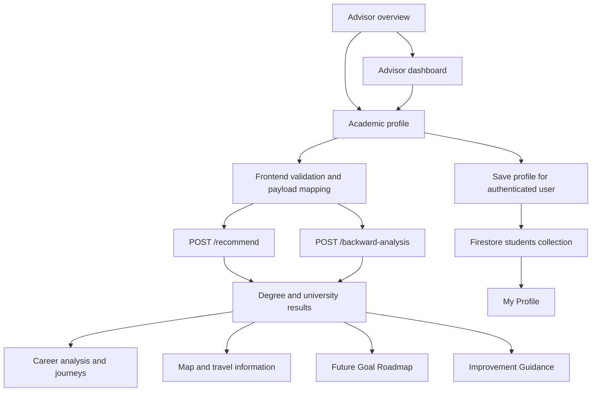

# Member 1 — Future Dream Degree Advisor

This guide describes the implemented Member 1 features, pages, navigation and supporting services in Studyfyx. It documents the current interface rather than treating every retained component as an active screen.

## 1. Component overview

The Future Dream Degree Advisor helps a student connect a career ambition with suitable education pathways. It combines the student's A/L stream, examination district, Z-score and optional profile evidence to provide:

- Ranked degree pathways and relevant university options.
- Subject and qualification requirements that need attention.
- Career-specific backward chains and forward journeys.
- Practical roadmaps, skill gaps and improvement scenarios.
- University locations, road-distance estimates and travel directions.

The component supports **60 career goals**, **25 Sri Lankan districts**, and **English, Sinhala and Tamil**. It includes academic, professional, specialist and vocational routes.

The module entry point is [index.jsx](index.jsx). The main application opens it through the protected `dreamDegreeAdvisor` view in [App.jsx](../src/App.jsx). The module then switches its own `currentView` state; its pages are not individual browser URL routes.

## 2. Complete page inventory

| Page / screen | View key | Source | Purpose |
| --- | --- | --- | --- |
| Advisor overview / landing page | `home` | [DreamDegreeHome.jsx](pages/DreamDegreeHome.jsx) | Introduces the advisor and opens the form or module dashboard. |
| Advisor dashboard | `dashboard` | [AdvisorDashboard.jsx](pages/AdvisorDashboard.jsx) | Summarises profile readiness and the current session's degree plan. |
| Academic profile / input form | `input` | [DreamDegreeInput.jsx](pages/DreamDegreeInput.jsx) | Collects the four essential inputs and optional evidence. |
| Degree and university results | `results` | [DreamDegreeResults.jsx](pages/DreamDegreeResults.jsx) | Presents predictions, universities, maps, preferences and career analysis. |
| Future Goal Roadmap | `roadmap` | [DreamDegreeRoadmap.jsx](pages/DreamDegreeRoadmap.jsx) | Displays the stages attached to a selected recommendation or career plan. |
| Improvement Guidance | `guidance` | [DreamDegreeGuidance.jsx](pages/DreamDegreeGuidance.jsx) | Explains requirements, missing evidence, scenarios and priority actions. |
| My Profile | `profile` | [StudentProfile.jsx](pages/StudentProfile.jsx) | Displays personal, academic, personality, skill and lifestyle information. |

Loading, profile-validation and connection-error screens are rendered by `index.jsx`; they are additional UI states, not separate page files.

### 2.1 Advisor overview

- Studyfyx branding and the supplied `src/assets/hom2.png` illustration.
- Overview, Features and How It Works sections.
- Degree recommendations, university options and roadmap feature cards.
- Four floating entry points around the illustration.
- **Build my degree plan** opens the input screen.
- **Launch App** opens the Member 1 dashboard.
- Language selection, a landing-page light/dark toggle and a Main Portal action.
- Career, district and language counts drawn from the supported data.

The landing-page theme toggle is local to that page; it is not a persistent theme preference for every module screen.

### 2.2 Advisor dashboard

- Personalised greeting when a user name is available.
- Completion count for the four essential profile fields.
- Counts of degree options and distinct recommended universities from current results.
- Latest plan summary, or an empty state before the first analysis.
- Academic profile summary: career, stream, district and Z-score.
- Shortcuts to update the profile, compare options, open the roadmap and view guidance.
- Results-dependent actions remain disabled until an analysis is available.

The dashboard shows the latest analysis held in the current advisor session. It does not implement a permanent analysis-history archive.

### 2.3 Academic profile / input screen

The current form uses one screen with expandable optional panels instead of requiring every student to complete a long multi-step wizard.

#### Essential information

| Field | Behaviour |
| --- | --- |
| Career goal | Select a supported career using search, translated names, category filters or search aliases. |
| A/L stream | Select one of the six supported admission stream classifications. |
| Examination district | Select one of the 25 Sri Lankan districts. |
| Z-score | Enter a finite number between `-4` and `4`; zero and negative values are supported. |

#### Optional information

| Panel | Information collected |
| --- | --- |
| Academic evidence | Up to three subject grades, Common General Test mark and a target/potential Z-score. |
| Strengths & skills | Ten personality self-assessments and skills relevant to the selected career. |
| Work preferences | Location, work-life balance, family attachment, salary priority, career growth, stress tolerance, social impact, travel tolerance, work environment and social interaction. |
| Personal details | Student name and age. |

Personality traits are analytical thinking, creativity, leadership, communication, problem solving, teamwork, adaptability, attention to detail, entrepreneurial mindset and risk taking. Personality and career-skill answers use a `0–10` scale. Unanswered values remain **Not assessed** rather than receiving an invented midpoint score.

Career-specific skills are requested from `/backward-analysis`. Changing the selected career resets the previous career's skill answers.

#### Subject filtering and validation

The supported stream labels are:

1. Biological Science.
2. Physical Science.
3. Commerce.
4. Arts.
5. Engineering Technology.
6. Bio Systems Technology.

Technology is represented by its two admission classifications. The common school grouping still has five main streams.

The form:

- Shows subject choices relevant to the selected stream.
- Uses required/core subjects and compatible third-subject choices where configured.
- Supports Arts subject categories and combination restrictions.
- Prevents duplicate subjects and more than three subject slots.
- Accepts subject grades `A`, `B`, `C`, `S` and `F`.
- Removes unrelated saved subjects when loading a profile or changing stream.
- Requests reselection when saved subjects do not identify an unambiguous three-subject combination.
- Keeps optional grades blank until supplied.
- Validates Common General Test marks within `0–100`, target Z-scores within `-4–4` and integer ages within `0–120` when supplied.
- Shows inline errors, opens relevant panels and attempts to focus the first invalid field.

The sidebar summary shows essential-field completion and the expected outputs. A separate submit action is available on mobile.

### 2.4 Results screen — all five tabs

The screen includes a profile/result summary followed by five tabs. The full career-pathway summary and recommendation-evidence sections appear only on Improvement Guidance; Future Path remains in the Career Analysis tab.

| Tab | Features |
| --- | --- |
| **Degree Predictions** | Ranked degree options, suitability explanations, subject checks, score evidence, trained-model recommendation and universities relevant to each pathway. Actions open the roadmap, guidance or a recommended university on the map. |
| **Universities & Cutoffs** | Degree-specific university filtering, government/private options, stored cutoff comparisons, verification statuses, selected-district travel information and preference stars. |
| **Map View** | Focuses on the university selected from recommendation results, showing the district origin, campus, routed road line, road distance, estimated driving time and external directions. |
| **Preferred** | Compares universities starred during the current results-screen session, including available reference scores/cutoffs and the student's Z-score. |
| **Career Analysis** | Career requirements, key skills, explicit career-role backward chains, forward journeys and expandable detailed steps. |

The standalone **All State Universities** directory tab is not part of the current results screen. The state-university data remains available to the recommendation backend.

#### Recommendation evidence (Improvement Guidance only)

The evidence sections explain:

- Whether a pathway is direct, related or alternative for the chosen goal.
- Subject prerequisites and unmet requirements.
- Missing information that prevents a stronger conclusion.
- The supplied factors and their scoring contributions.
- How the goal, qualification routes, stream and profile evidence were considered.
- Recomputed what-if scenarios.
- A prioritised action plan.

The earlier research-reference banner is commented out in the UI. The limitations of the data and professional verification requirements still apply.

### 2.5 Future Goal Roadmap

- Opens from a recommendation or from the module dashboard/sidebar after analysis.
- Displays career-specific stages, descriptions and planning/verification statuses.
- Shows degree, institution, relevant skills or checks when those fields are available.
- Supports vocational plans even when there is no degree recommendation.
- Refreshes older saved stage descriptions from the current career catalog while retaining relevant student evidence.
- Offers navigation back to results or the advisor dashboard.

The current backend supplies structured `roadmap_stages`. Older fallback rendering also exists in this file; its historical year/GPA/internship examples are not the source of the current structured recommendations.

### 2.6 Improvement Guidance

For current schema `2.0` responses, the page uses the shared recommendation-evidence component to display:

- Career and qualification requirements.
- Missing or unmet evidence.
- The explanation of how the plan was produced.
- Recomputed scenarios and priority actions.

Scenarios can test a Z-score increase of `0.2`, a supplied higher potential Z-score, or improvement in the largest assessed skill gap. Each scenario changes the named input and recomputes the recommendation with the other inputs held fixed. It is not a guaranteed admission outcome.

This page also retains an older heuristic fallback for legacy responses. Descriptions in that branch should not be treated as verified current admission rules.

### 2.7 My Profile

Five sections organise the profile:

| Section | Contents |
| --- | --- |
| Overview | Identity information, career goal, essential-field readiness and profile summary. |
| Academic | Stream, district, Z-score, subjects and supplied academic evidence. |
| Personality | Assessed personality traits and scores. |
| Career skills | Supplied career-skill assessments. |
| Lifestyle | Supplied work and lifestyle preferences. |

The page prefers the latest in-memory profile passed by the advisor. When that is unavailable, an authenticated user can load the saved Firestore profile. It includes loading, empty, unavailable and retry states, preserves valid zero scores and displays missing values explicitly.

## 3. Career-role backward chaining and forward journeys

Every supported career has an explicit, trilingual `careerJourney` in [careerCatalog.json](data/careerCatalog.json). These ladders are separate from the longer task descriptions in `futurePathSteps`.

The presentation contains:

1. **Dream job** — the target shown to the student.
2. **Work backwards from this goal** — roles and prerequisites leading back towards education and entry preparation.
3. **Your path forward** — a practical forward journey.
4. **View detailed steps** — expandable explanations.

Examples of the advanced targets displayed for selected careers:

| Selected career | Displayed target | Main progression |
| --- | --- | --- |
| Software Engineer | Senior Software Engineer | Internship → junior role → software engineer → senior responsibilities. |
| Doctor | Specialist Doctor | Recognised medical degree → provisional registration → internship → full registration → Medical Officer experience → recognised postgraduate specialist training/certification and specialist registration. |
| Civil Engineer | Senior Civil Engineer | Civil engineering degree → internship → junior/graduate role → civil engineer → senior responsibilities. |
| Lawyer | Senior Lawyer | Eligible legal education route → required professional examinations → practical training/apprenticeship and applicable enrolment → practising Attorney-at-Law → experienced/legal specialist → senior work. |

The Doctor overview includes the advanced specialist target; the underlying general-Doctor entry assessment remains separate from specialist eligibility. The Law route allows an eligible alternative to an LLB rather than implying that every legal route requires the same degree. Civil Engineering identifies the checked UGC subject route without treating all providers as having identical admission policies.

Career titles and progression are planning examples. They do not establish mandatory employer ranks, fixed promotion dates or completed professional qualifications.

The selected career and current catalog take priority over old saved journey text, preventing a previous software engineering path from appearing for another job.

## 4. Degree and university recommendation logic

Member 1 uses a **hybrid recommendation process**, rather than a trained model alone:

1. Validate and normalise the profile.
2. Find qualification/degree routes configured for the selected career.
3. Apply stream constraints and subject requirements.
4. Match degree pathways to institutions in the bundled catalog.
5. Compare available stored cutoff references with the supplied Z-score.
6. Score the assessed factors and rank pathways.
7. Produce explanations, a career plan, skill gaps and improvement scenarios.

The default factor weights in [advisor_engine.py](../../backend/advisor_engine.py) are:

| Factor | Base weight |
| --- | ---: |
| Career-goal alignment | 35% |
| Academic reference readiness | 25% |
| Personality evidence | 15% |
| Lifestyle preferences | 10% |
| Assessed skills | 10% |
| Compatible trained-model evidence | 5% |

Missing/unassessed factors are excluded and the remaining weights are redistributed. Model evidence is excluded from ranking when it is unavailable, incompatible or depends on imputed inputs.

### What the outputs mean

- **Model score/probability:** the classifier's internal degree-class output. It is not admission probability or an individual student's accuracy score. The bundled model's synthetic training basis and lack of probability calibration limit interpretation.
- **Suitability score:** a weighted comparison with the configured career/profile rules. It can differ from the model's top class.
- **University recommendation:** a catalog match for the recommended degree, subject checks and reference data. The degree classifier does not independently predict a university.
- **Cutoff comparison:** comparison with a stored reference, not confirmation of current district/year admission eligibility.
- **Professional route:** related degrees do not substitute for required professional qualifications, registration, licensing or supervised practice.
- **Vocational route:** can return a training roadmap without fabricating a degree or university result.

The state catalog contains **22 institutions: 17 UGC universities and five other state institutions**. This does not mean every institution will match every degree. The private/institution catalog is limited to the records currently bundled with the application; it is not a claim of exhaustive national coverage.

There are no live vacancy, salary or labour-market forecast integrations in this module.

## 5. District-to-university travel features

The origin is a representative town in the student's selected district. The destination is the resolved campus coordinate for the recommended/selected institution.

- University cards display routed road kilometres and estimated driving time.
- Map View shows the origin marker, university marker and returned road geometry.
- Road names/references are displayed when returned by the routing service.
- Available route alternatives are compared by distance.
- The selected route is the **shortest returned alternative**, not a guarantee of the absolute shortest route across all possible roads.
- Google Maps links offer driving directions and bus/train options for the same endpoints.
- Straight-line distance is separately labelled; it is not substituted for road distance after a routing failure.
- Missing/stale saved campus coordinates can be repaired from the sourced campus records.
- Cards and maps share a five-minute route cache and limit concurrent route requests to three.
- Routing failures show an unavailable/retry state instead of invented road kilometres or travel times.

Routing uses **OSRM** and mapping uses **Leaflet/OpenStreetMap**. Distances start from the district town, not the student's home. Driving estimates are not live-traffic ETAs. Bus route numbers, fares and schedules are not generated internally; public-transport links open an external service.

## 6. Language, layout and navigation

- English (`en`), Sinhala (`si`) and Tamil (`ta`) use the shared application language context.
- The selected language is stored under `appLanguage` in browser local storage.
- Display translation preserves canonical English identifiers used by the API and stored profile.
- Career descriptions, ladders, detailed steps, subject guidance and advisor UI copy have shared translation data.
- The module includes the Studyfyx logo, shared brand styling, responsive cards and mobile layouts.
- Desktop navigation can collapse; mobile navigation opens from a hamburger button and closes through its close button, backdrop or Escape key.
- Results and guidance require an analysis; roadmap navigation requires an available plan.
- Main Portal returns to the containing student portal through the parent callback.

Mentor Hub, Career AI and Stress Analytics are separate Studyfyx modules. Member 1 provides advisor navigation and profile integration; it does not implement their matching, job-readiness or stress models.

## 7. Data flow and persistence



`index.jsx` requests recommendations and backward analysis in parallel. A separate backward-analysis request failing does not by itself block a successful recommendation response; the recommendation's embedded analysis is preferred when available.

For authenticated users, the profile is merged into `students/{uid}` in Firestore, including academic data, career, assessments, preferences and an update timestamp. Undefined values are removed before saving. A save failure is logged without discarding a successful analysis.

Current recommendations are held in React state. Preferred university stars are held in the results component's state. Neither should be described as a permanently saved result archive or persistent favourites database.

## 8. Backend and API integration

Frontend API access is implemented in [apiService.js](services/apiService.js). The base URL is `VITE_BACKEND_URL`, falling back to `http://localhost:8006`.

| Method | Endpoint | Purpose |
| --- | --- | --- |
| `GET` | `/` | API identity and framework/version information. |
| `GET` | `/health` | Service health, model load/inference status and rule version. |
| `POST` | `/recommend` | Validated, profile-based degree/university recommendations and embedded analysis. |
| `POST` | `/backward-analysis` | Goal-only career requirements or profile-based backward analysis. |
| `POST` | `/predict-simple` | Compatibility endpoint backed by the validated advisor flow. |

Example minimum recommendation request:

```json
{
  "dream_job": "Civil Engineer",
  "stream": "Physical Science",
  "district": "Ratnapura",
  "z_score": 1.5
}
```

Optional academic evidence can include:

```json
{
  "subject_grades": {
    "Combined Mathematics": "B",
    "Physics": "B",
    "Chemistry": "C"
  },
  "common_general_test": 65
}
```

A goal-only request to `/backward-analysis` can contain just `{"dream_job":"Doctor"}`. This provides career knowledge, not personalised skill-gap or admission conclusions.

Important response fields include `recommendations`, `best_degree`, `trained_model_recommendation`, `university_recommendations`, `backward_analysis`, `career_plan`, `counterfactual_scenarios`, `action_plan`, `validation`, `model_info` and version metadata. The explicit role chain is exposed as `career_journey` with `goal`, `backward` and `forward` fields.

Backend validation returns structured field errors for missing/unsupported inputs, malformed data, invalid numbers, duplicate subjects and invalid subject combinations. Unproven goal requirements remain unknown rather than being silently marked satisfied.

## 9. Important source files

| File / area | Responsibility |
| --- | --- |
| [index.jsx](index.jsx) | Module state, navigation, loading/errors, analysis requests and profile saving. |
| [AdvisorModuleLayout.jsx](components/AdvisorModuleLayout.jsx) | Shared dashboard shell, sidebar and mobile navigation. |
| [AdvisorHeader.jsx](components/AdvisorHeader.jsx) | Shared logo, language controls and portal/profile actions. |
| [StreamSubjectFields.jsx](components/StreamSubjectFields.jsx) | Current stream-dependent subject controls. |
| [CareerSkillAssessment.jsx](components/CareerSkillAssessment.jsx) | Loads relevant skills and collects optional scores. |
| [TrainedModelRecommendation.jsx](components/TrainedModelRecommendation.jsx) | Separates the model's degree suggestion from hybrid recommendations. |
| [DegreeUniversityOptions.jsx](components/DegreeUniversityOptions.jsx) | Universities associated with an individual degree pathway. |
| [RecommendationEvidence.jsx](components/RecommendationEvidence.jsx) | Requirements, score evidence, scenarios and actions. |
| [CareerPlanSummary.jsx](components/CareerPlanSummary.jsx) | Career qualification summary, medical entry assessment and explicit backward chain. |
| [FutureCareerPath.jsx](components/FutureCareerPath.jsx) | Dream-job label, backward/forward journeys and expandable details. |
| [UniversityMap.jsx](components/UniversityMap.jsx) | Campus/origin markers and road-route map. |
| [UniversityDistance.jsx](components/UniversityDistance.jsx) | Road distance/time on university cards. |
| [useRoadRoute.js](components/useRoadRoute.js) | Routing state shared by travel components. |
| [advisorIntake.js](data/advisorIntake.js) | Draft normalisation, saved-subject cleanup and form validation. |
| [alSubjectRules.json](data/alSubjectRules.json) | Shared stream and course-subject reference rules. |
| [careerCatalog.json](data/careerCatalog.json) | All 60 career profiles, skills, qualifications, milestones and role ladders. |
| [careerFuturePaths.js](data/careerFuturePaths.js) | Resolves current journeys and refreshes older saved plan text. |
| [stateUniversities.json](data/stateUniversities.json) | State institution directory, categories, aliases and source links. |
| [districtOrigins.json](data/districtOrigins.json) | Representative district-town origin coordinates. |
| [universityDistances.js](data/universityDistances.js) | Coordinate resolution, straight-line measurements and direction links. |
| [roadRoutes.js](data/roadRoutes.js) | OSRM request parsing, route selection, caching and concurrency. |
| [advisorLocale.js](data/advisorLocale.js) | Collects display translations from dictionaries and the catalog. |
| [flask_app.py](../../backend/flask_app.py) | Member 1 Flask entry point, API routes and model loading. |
| [advisor_engine.py](../../backend/advisor_engine.py) | Validation, ranking, university matching, evidence and scenarios. |
| [career_pathways.py](../../backend/career_pathways.py) | Backend career plans and explicit journeys. |
| [al_subjects.py](../../backend/al_subjects.py) | Backend subject normalisation and prerequisite evaluation. |
| [ADVISOR_VALIDATION.md](../../backend/ADVISOR_VALIDATION.md) | Detailed validation history, data limitations and implementation notes. |

Retained components such as `InputOnboarding`, `InputStepPersonal`, `InputStepAcademic`, `InputStepPersonality`, `InputStepLifestyle`, the older `DreamHome*` components, `Student3D`, `OnboardingAnimations` and `StateUniversityDirectory` are not separate pages in the current seven-page flow. The active form is `DreamDegreeInput.jsx`.

## 10. Running and checking Member 1

From the repository root, start the Member 1 backend using a compatible Python environment:

```sh
cd backend
python flask_app.py
```

In another terminal, start the shared frontend:

```sh
cd edusoul-app
npm run dev
```

The configured frontend address is **http://localhost:5174** and the Member 1 API is **http://localhost:8006**. Check the actual Vite output if the configured port is occupied. The main app uses authentication; enter the advisor through the student portal rather than assuming a separate `/member1` URL.

Use the dependencies in [requirements-advisor.txt](../../backend/requirements-advisor.txt) for the verified advisor model environment. That pinned dependency set documents Python `3.9–3.12` compatibility and scikit-learn `1.6.1`; a different pickle/runtime combination may disable inference or fail to load correctly. The UI can still explain when it is using research rules without model evidence.

On Windows, `start_all.bat` launches the shared frontend and all four member backends. Its printed frontend port is older than the current Vite setting; use the address actually printed by Vite. macOS cannot execute a Windows batch file natively.

Verification commands from the repository root:

```sh
# Backend behaviour and integration tests
python -m unittest discover -s backend/tests

# Member 1 frontend data, validation, translation and routing tests
cd edusoul-app
node --test Member1/tests/*.test.mjs

# Shared frontend production build
npm run build
```

At the latest implementation check, **47 backend tests** and **90 frontend tests** passed. Production build, targeted lint and browser checks also passed. Browser checks included all career ladders in three languages, stale saved-result handling, the actual Doctor/Civil Engineer/Lawyer Career Analysis screen and mobile layout. These are implementation checks, not proof of real-world prediction accuracy or guaranteed admission.

## 11. Complete supported career list

The categories and names below come from the current shared career catalog.

| Category | Careers |
| --- | --- |
| Agriculture | Agricultural Scientist |
| Arts | Graphic Designer |
| Aviation | Pilot |
| Business | Entrepreneur, Marketing Manager, Human Resources Manager, Business Analyst, Product Manager, Supply Chain Analyst, Logistics Coordinator, Digital Marketing Specialist, E-commerce Manager, Project Coordinator, Export Operations Coordinator, Apparel Merchandiser |
| Design | Architect, UX Designer, Animation Artist |
| Education | Teacher |
| Engineering | Civil Engineer, Mechanical Engineer, Biomedical Engineer, Electrical Engineer, Quantity Surveyor |
| Finance | Accountant, Financial Analyst |
| Healthcare | Doctor, Nurse, Psychologist, Pharmacist, Dentist, Veterinarian |
| Hospitality | Chef, Hotel Operations Manager, Tour Guide, Travel Consultant |
| Legal | Lawyer |
| Media | Journalist |
| Public Service | Police Officer |
| Science | Environmental Scientist, Food Technologist, Industrial Laboratory Technician |
| Social Services | Social Worker |
| Technology | Software Engineer, Data Scientist, Web Developer, Cybersecurity Analyst, AI Engineer, Data Analyst, Cloud Engineer, DevOps Engineer, Software QA Engineer, Mobile Application Developer, Network Engineer |
| Trades | Electrician, Renewable Energy Technician, Solar PV Installer, HVAC Technician, Automotive Technician, Welder |
